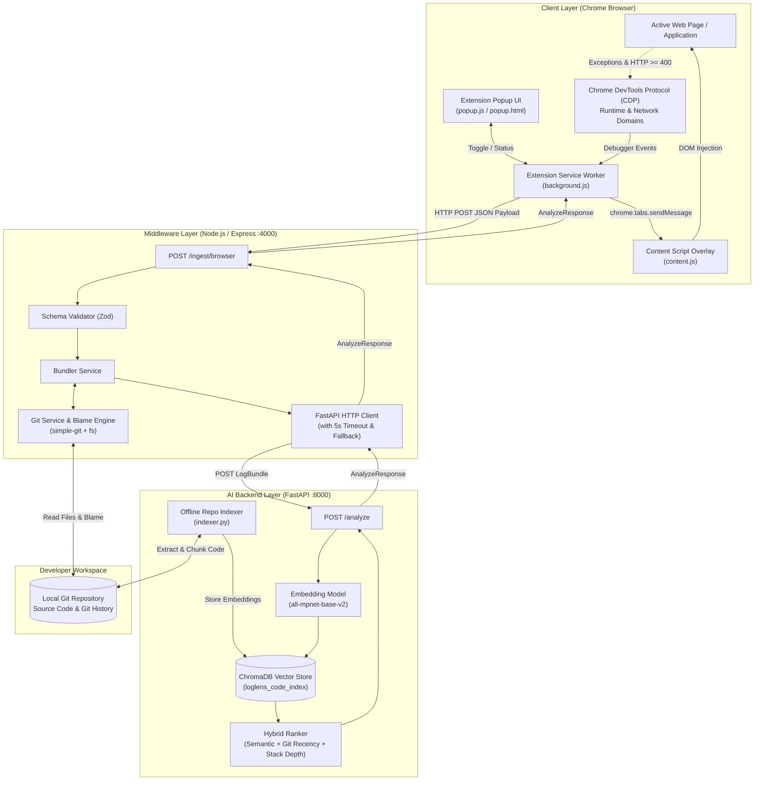
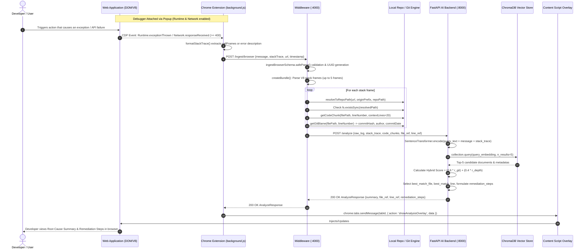

# LogLens System Architecture & Data Flow Specification

## 1. Executive Summary & Product Overview

**LogLens** is an automated root-cause analysis (RCA) and runtime diagnostics platform designed to bridge the gap between browser runtime failures (uncaught client exceptions, network HTTP failures) and local source code repositories. 

The system operates as a 3-tier monorepo architecture:
1. **Client / Ingestion Layer (`extension/`)**: A Chrome Extension (Manifest V3) that taps into the Chrome DevTools Protocol (CDP) via the `chrome.debugger` API to capture runtime exceptions and failed network responses with zero instrumentation required in the target web application.
2. **Orchestration & Context Enrichment Layer (`middleware/`)**: A Node.js / Express microservice in TypeScript that validates incoming telemetry, normalizes V8 stack traces, resolves client URLs back to local workspace source paths, extracts code snippets, enriches them with Git commit/blame history, and packages them into unified bundles.
3. **Reasoning & Vector Retrieval Layer (`backend/`)**: A Python FastAPI service backed by ChromaDB and Sentence Transformers (`all-mpnet-base-v2`) that indexes repository source code chunks and applies a hybrid ranking model (combining semantic relevance, Git commit recency, and stack depth) to identify root causes and generate concrete remediation steps.

---

## 2. System Architecture Diagram



---

## 3. Detailed End-to-End Data Flow

The complete lifecycle of an error from client occurrence to remediation display follows 6 discrete stages:



---

## 4. Component Deep Dive

### 4.1 Chrome Extension (`extension/`)

* **Technology**: Chrome Extension Manifest V3, Vanilla JavaScript, Chrome DevTools Protocol (`chrome.debugger` API).
* **Key Files**:
  * `manifest.json`: Configures permissions (`debugger`, `activeTab`, `storage`, `tabs`), host permissions (`http://localhost:4000/*`, `<all_urls>`), background service worker, and content scripts.
  * `background.js`:
    * Controls the debugging session lifecycle via `chrome.debugger.attach()` and `detach()`.
    * Enables CDP domains: `Runtime.enable` and `Network.enable`.
    * Captures `Runtime.exceptionThrown`: parses `params.exceptionDetails` and serializes stack frames into standard `functionName@url:line:col` lines.
    * Captures `Network.responseReceived`: intercepts HTTP statuses $\ge 400$ and converts them to error payloads.
    * Transmits payloads to `http://localhost:4000/ingest/browser`.
    * Dispatches the analysis response to the active tab via `chrome.tabs.sendMessage`.
  * `content.js`:
    * Listens for `showAnalysisOverlay`.
    * Injects a floating DOM panel (`#loglens-overlay`) positioned at the bottom right (`z-index: 9999999`).
    * Displays error summary, resolved file and line references, and remediation action items.
  * `popup.html` & `popup.js`:
    * Minimal dashboard interface with toggle controls ("Start Capture" / "Stop Capture") and status indicators synchronized with `chrome.storage.local`.

### 4.2 Middleware Orchestrator (`middleware/`)

* **Technology**: Node.js, Express, TypeScript, Zod, simple-git.
* **Key Files**:
  * `src/app.ts`: Express application entry point configuring JSON middleware and route handlers (`GET /health`, `POST /ingest/browser`).
  * `src/schemas/ingest.schema.ts`: Zod schema validating incoming payloads:
    * `message`: Non-empty string.
    * `stackTrace`: Optional string.
    * `url`: Non-empty string.
    * `timestamp`: String or Unix numeric timestamp.
  * `src/services/gitService.ts`:
    * `parseStackFrame(line)`: Uses regex `^(.+):(\d+):(\d+)$` with delimiter `@` to extract function name, URL, line number, and column number.
    * `resolveToRepoPath(url, originPrefix, repoPath)`: Strips base origin (e.g. `http://localhost:3000/`) and maps URL to absolute local filesystem path.
    * `getCodeChunk(filePath, lineNumber, contextLines=20)`: Reads source file on disk and slices a window of $\pm 20$ lines around the error line.
    * `getGitBlame(filePath, lineNumber, repoPath)`: Executes `git blame -L <line>,<line> --porcelain` to extract commit SHA, author name, and ISO commit timestamp.
  * `src/services/bundlerService.ts`:
    * Filters frames and skips third-party/CDN scripts that do not exist in the local workspace.
    * Enforces a ceiling of the first 5 resolvable code frames.
    * Pointers `file_ref` and `line_ref` are assigned to the topmost resolved source frame.
  * `src/services/fastApiClient.ts`:
    * Communicates with FastAPI via HTTP POST with a 5000ms timeout (`AbortController`).
    * Implements circuit breaker / fallback semantics: if FastAPI fails, times out, or returns a 5xx error, it gracefully falls back to:
      ```json
      {
        "summary": "Analysis unavailable — backend error",
        "file_ref": "<fallback_or_unknown>",
        "line_ref": 0,
        "remediation_steps": []
      }
      ```

### 4.3 AI Reasoning Backend (`backend/`)

* **Technology**: Python 3.10+, FastAPI, ChromaDB, Sentence Transformers (`all-mpnet-base-v2`), GitPython.
* **Key Files**:
  * `indexer.py`:
    * Repository ingestion tool run periodically or on CI/CD commits.
    * Scans files matching extensions `*.js`, `*.jsx`, `*.ts`, `*.tsx`, `*.py`.
    * Excludes build artifacts and dependencies: `node_modules`, `.git`, `venv`, `dist`, `build`, `__pycache__`.
    * Chunks source code using word sliding windows (size: 512 words, overlap: 64 words).
    * Binds current Git HEAD commit metadata (hash, commit date) to each chunk metadata.
    * Embeds chunks into 768-dimensional vector space using `all-mpnet-base-v2` and persists them into ChromaDB (`loglens_code_index`).
  * `main.py`:
    * Serves `GET /health` and `POST /analyze`.
    * Encodes incoming `{raw_log.message} {stack_trace}` into dense vector embeddings.
    * Queries ChromaDB for top 5 nearest neighbor semantic chunks.
    * Computes hybrid ranking scores:
      $$r_{\text{git}} = \frac{1.0}{1.0 + \frac{\max(0, \Delta_{\text{days}})}{7.0}}$$
      $$r_{\text{depth}} = 1.0 - \frac{\text{frame\_index}}{\text{total\_frames}}$$
      $$\text{Score} = \alpha \cdot r_{\text{git}} + (1 - \alpha) \cdot r_{\text{depth}} \quad (\alpha = 0.6)$$
    * Combines semantic and temporal ranking to localize the failure and synthesizes an `AnalyzeResponse`.

---

## 5. Data Contracts & Schema Reference

### 5.1 Ingestion Payload (`extension -> middleware`)
```json
{
  "message": "Uncaught TypeError: Cannot read properties of undefined (reading 'prop')",
  "stackTrace": "renderApp@http://localhost:3000/src/App.js:42:12\nmain@http://localhost:3000/src/index.js:10:5",
  "url": "http://localhost:3000/src/App.js",
  "timestamp": "2026-10-12T16:30:00.000Z"
}
```

### 5.2 Bundle Request (`middleware -> backend`)
```json
{
  "raw_log": {
    "message": "Uncaught TypeError: Cannot read properties of undefined (reading 'prop')",
    "stackTrace": "renderApp@http://localhost:3000/src/App.js:42:12\nmain@http://localhost:3000/src/index.js:10:5",
    "url": "http://localhost:3000/src/App.js",
    "timestamp": "2026-10-12T16:30:00.000Z"
  },
  "stack_trace": "renderApp@http://localhost:3000/src/App.js:42:12\nmain@http://localhost:3000/src/index.js:10:5",
  "code_chunks": [
    {
      "filePath": "D:/Log-Lens/middleware/src/App.js",
      "lineNumber": 42,
      "code": "const value = obj.prop;",
      "gitMeta": {
        "commitHash": "a71432109876543210abcdef0123456789abcdef",
        "commitDate": "2026-10-10T14:20:00.000Z",
        "author": "Alice Developer"
      }
    }
  ],
  "file_ref": "D:/Log-Lens/middleware/src/App.js",
  "line_ref": 42
}
```

### 5.3 Analysis Response (`backend -> middleware -> extension -> content script`)
```json
{
  "summary": "Runtime anomaly detected: Uncaught TypeError: Cannot read properties of undefined. Semantic and temporal analysis localized issue.",
  "file_ref": "D:/Log-Lens/middleware/src/App.js",
  "line_ref": 42,
  "remediation_steps": [
    "Inspect variable initialization and null-checks in D:/Log-Lens/middleware/src/App.js around line 42.",
    "Verify recent Git commit modifications and stack trace depth priors.",
    "Apply defensive error boundaries to gracefully handle unexpected exceptions."
  ]
}
```

---

## 6. Security, Configuration & Deployment Notes

### 6.1 Configuration Matrix

| Component | Variable | Default | Purpose |
| :--- | :--- | :--- | :--- |
| **Middleware** | `PORT` | `4000` | HTTP port on which the Express middleware listens |
| **Middleware** | `ORIGIN_PREFIX` | `http://localhost:3000/` | Base URL used to strip Webpack/Vite origins from source URLs |
| **Middleware** | `REPO_PATH` | `process.cwd()` | Root path of the local target repository being analyzed |
| **Middleware** | `BACKEND_URL` | `http://localhost:8000` | Target URL for the Python FastAPI reasoning service |
| **Backend** | `CHROMA_DB_PATH` | `./chroma_db` | Storage path for ChromaDB vector embeddings |
| **Backend** | `EMBED_MODEL` | `all-mpnet-base-v2` | SentenceTransformers pre-trained model name |

### 6.2 Key Operational Strengths
- **Non-Intrusive**: No SDK or NPM package needs to be installed in the target web application. CDP monitors exceptions passively at browser runtime.
- **Fail-Safe Circuit Breaker**: Middleware incorporates a 5-second timeout and graceful degradation; an unavailable Python backend will never crash or hang the extension.
- **Hybrid Heuristic Localizer**: Combines semantic embeddings with Git recency ($r_{\text{git}}$) and stack trace depth ($r_{\text{depth}}$) to give higher weight to freshly committed code paths where bugs are most frequently introduced.
